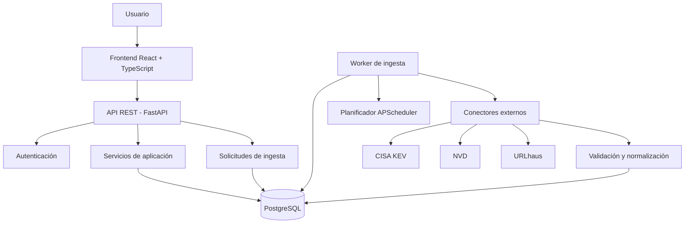
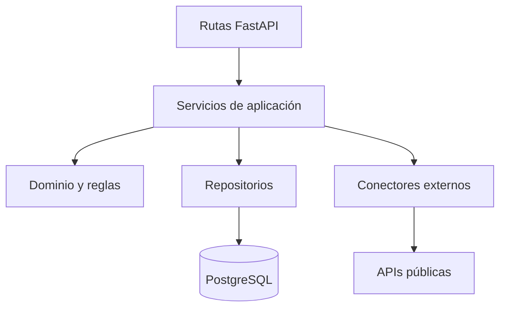
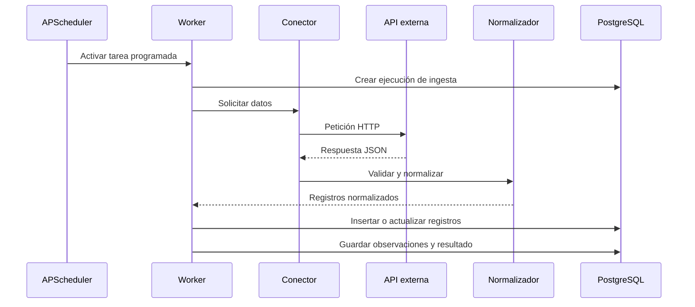
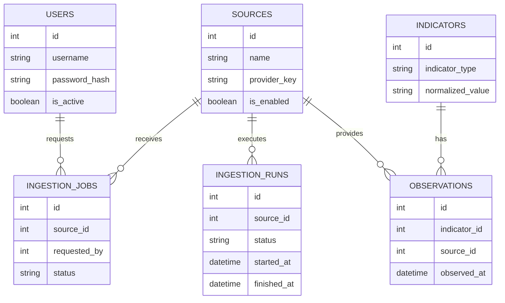
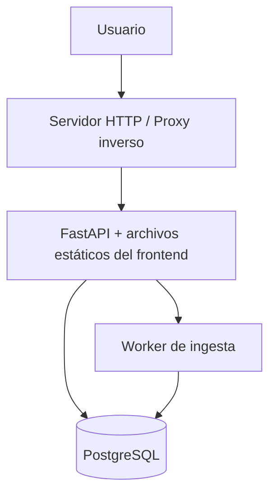

# Architecture Design Document (ADD)
## Global Threat Intelligence Platform (GTIP)

**Versión:** 1.0 — Propuesta inicial  
**Estado:** Borrador para implementación  
**Tipo de proyecto:** Proyecto universitario de desarrollo de software y ciberseguridad  
**Arquitectura:** Monolito modular con proceso de ingesta independiente  
**Stack principal:** Python, FastAPI, React, TypeScript y PostgreSQL  
**Duración estimada del MVP:** 6 semanas  
**Restricción principal:** Priorizar servicios gratuitos, fuentes públicas y despliegue de bajo costo.

---

# 1. Introducción

## 1.1. Propósito

Este documento describe la arquitectura técnica de Global Threat Intelligence Platform (GTIP): sus componentes, responsabilidades, comunicación, almacenamiento, seguridad, despliegue y estrategia de pruebas.

El documento complementa el Product Requirements Document (PRD), que define los objetivos funcionales, el alcance y los entregables académicos.

## 1.2. Objetivo del sistema

GTIP centralizará información pública sobre amenazas informáticas obtenida de diferentes fuentes. La plataforma normalizará los datos, los almacenará en una base de datos propia y permitirá consultarlos desde una interfaz web y una API REST.

El MVP se centrará en vulnerabilidades conocidas e indicadores de compromiso (IOC), conservando la procedencia y el historial de las observaciones.

GTIP **no será un SIEM completo**: no recopilará de forma generalizada registros internos, no analizará tráfico de red en tiempo real y no ejecutará respuestas automáticas a incidentes.

## 1.3. Alcance arquitectónico

El diseño contempla:

- Aplicación web con autenticación.
- API REST desarrollada con FastAPI.
- Integración con fuentes externas de inteligencia.
- Normalización y deduplicación de información.
- Persistencia en PostgreSQL.
- Ejecución manual y periódica de ingestas.
- Historial y estado de las ingestas.
- Pruebas automatizadas.
- Desarrollo local y despliegue mediante Docker Compose.

## 1.4. Convenciones del documento

Las decisiones se clasifican de la siguiente manera:

- **Definido:** requisito procedente del PRD o de las respuestas del usuario.
- **Propuesto:** decisión técnica recomendada para implementar el sistema.
- **Pendiente:** detalle que deberá verificarse o concretarse durante el desarrollo.

---

# 2. Requisitos arquitectónicos

## 2.1. Requisitos funcionales

La arquitectura debe permitir:

1. Obtener información de al menos tres fuentes externas.
2. Consultar vulnerabilidades y sus identificadores CVE.
3. Buscar indicadores por tipo y valor.
4. Agrupar observaciones relacionadas con un mismo indicador.
5. Conservar la procedencia de cada observación.
6. Detectar registros duplicados y actualizar los existentes.
7. Ejecutar ingestas manuales y periódicas.
8. Consultar el estado y el historial de las ingestas.
9. Mostrar la información en un dashboard.
10. Exigir autenticación para acceder a la aplicación.

## 2.2. Requisitos no funcionales

| Requisito | Decisión arquitectónica |
|---|---|
| Bajo costo | Dependencias y servicios gratuitos siempre que sea posible |
| Mantenibilidad | Código organizado en módulos por responsabilidad |
| Trazabilidad | Identificar fuente, fecha y referencia externa |
| Persistencia | PostgreSQL con migraciones |
| Disponibilidad de datos | Los datos almacenados siguen siendo consultables aunque falle una fuente |
| Seguridad | Autenticación, validación de entradas y gestión segura de secretos |
| Reproducibilidad | Docker Compose y documentación de instalación |
| Calidad | Pruebas unitarias, de integración y API automatizadas |
| Evolución | Incorporación de nuevos conectores sin rediseñar la aplicación |

El PRD establece como prioridad la trazabilidad, la calidad de los datos y la integración funcional, en lugar de la cantidad de funcionalidades. <FileCite ref_id="turn1file4" />

---

# 3. Decisiones arquitectónicas principales

| ID | Decisión | Justificación |
|---|---|---|
| ADR-01 | Monolito modular | Evita la complejidad de microservicios |
| ADR-02 | Worker independiente | Las ingestas no deben depender del ciclo de vida de una petición HTTP |
| ADR-03 | PostgreSQL | Proporciona persistencia relacional y restricciones para evitar duplicados |
| ADR-04 | React servido junto al backend | Simplifica el despliegue y evita configurar CORS entre dominios |
| ADR-05 | JWT para autenticación | Permite proteger la API mediante tokens de acceso |
| ADR-06 | Scheduler en el worker | Mantiene la planificación de ingestas fuera del servidor HTTP |
| ADR-07 | Solicitudes de ingesta persistidas en PostgreSQL | Evita incorporar Redis o un sistema de mensajería al MVP |
| ADR-08 | Docker Compose | Facilita ejecutar los componentes de forma reproducible |
| ADR-09 | Fuentes gratuitas como base | Reduce el riesgo económico del proyecto |
| ADR-10 | API versionada | Permite evolucionar los endpoints sin cambiar toda la interfaz |

Estas decisiones están orientadas a una aplicación académica con un único desarrollador y volumen de datos moderado.

---

# 4. Vista general de la arquitectura

## 4.1. Diagrama de componentes



## 4.2. Explicación

**Frontend:** presenta los datos al usuario, permite buscar información y muestra el estado de las fuentes.

**API FastAPI:** recibe las peticiones del frontend, verifica la autenticación, ejecuta la lógica de aplicación y devuelve respuestas JSON.

**Servicios de aplicación:** contienen las operaciones principales, como buscar indicadores, consultar vulnerabilidades y solicitar ingestas.

**PostgreSQL:** almacena usuarios, fuentes, vulnerabilidades, indicadores, observaciones y ejecuciones de ingesta.

**Worker:** ejecuta las ingestas fuera del servidor HTTP. Consulta las solicitudes pendientes, ejecuta conectores y registra los resultados.

**Conectores:** se comunican con las fuentes externas y transforman sus respuestas al formato interno de GTIP.

El worker y la API compartirán el mismo código de aplicación, pero se ejecutarán como procesos independientes. No serán microservicios independientes con bases de código distintas.

---

# 5. Arquitectura lógica del backend

## 5.1. Organización por capas

El backend utilizará una arquitectura por capas con responsabilidades explícitas.

### Capa de presentación

Responsable de recibir solicitudes HTTP y devolver respuestas.

Incluye:

- Rutas y endpoints de FastAPI.
- Esquemas de entrada y salida.
- Dependencias de autenticación.
- Validación inicial de parámetros.
- Códigos de estado HTTP y manejo de errores de API.

Esta capa no debe contener lógica compleja de ingesta ni consultas SQL dispersas.

### Capa de aplicación

Coordina las operaciones que ofrece GTIP.

Ejemplos:

- Consultar vulnerabilidades.
- Buscar indicadores.
- Consultar observaciones.
- Solicitar una ingesta.
- Consultar el historial de ejecución.
- Obtener estadísticas para el dashboard.

Los servicios de aplicación utilizan los repositorios y conectores necesarios sin depender de las rutas HTTP.

### Capa de dominio

Contiene las reglas principales del sistema:

- Representación de vulnerabilidades e indicadores.
- Normalización de tipos y valores.
- Reglas de deduplicación.
- Relación entre indicadores, fuentes y observaciones.
- Estados válidos de una ejecución de ingesta.

El dominio no debe depender de React, FastAPI ni de una API externa concreta.

### Capa de infraestructura

Implementa los mecanismos técnicos:

- Acceso a PostgreSQL.
- SQLAlchemy y Alembic.
- Clientes HTTP mediante HTTPX.
- Conectores para proveedores.
- Gestión de configuración.
- Ejecución programada mediante APScheduler.

Esta separación permite cambiar la implementación de una fuente o de la persistencia sin modificar todas las partes del sistema.

## 5.2. Diagrama de capas



---

# 6. Componentes del sistema

## 6.1. Frontend

**Tecnología:** React + TypeScript.

Responsabilidades:

- Mostrar el formulario de inicio de sesión.
- Mostrar el dashboard.
- Consultar vulnerabilidades.
- Buscar indicadores.
- Mostrar las fuentes disponibles.
- Consultar el historial de ingesta.
- Permitir solicitar una ingesta manual.
- Presentar estados de carga y errores.

El frontend consumirá la API bajo el prefijo `/api/v1`.

La aplicación no se conectará directamente con CISA, NVD, URLhaus, AbuseIPDB ni OTX. Toda integración con proveedores externos será responsabilidad del backend.

## 6.2. API REST

**Tecnología:** FastAPI.

Responsabilidades:

- Autenticar solicitudes.
- Validar entradas.
- Ejecutar servicios de aplicación.
- Consultar la base de datos.
- Crear solicitudes de ingesta.
- Exponer resultados normalizados.
- Documentar los endpoints mediante OpenAPI.

## 6.3. Servicio de autenticación

Responsabilidades:

- Verificar credenciales.
- Validar contraseñas.
- Emitir tokens de acceso.
- Validar tokens en endpoints protegidos.
- Identificar al usuario que solicita una operación.

Se propone utilizar contraseñas con hash seguro mediante Argon2id y tokens JWT de corta duración.

Para el MVP, la creación de cuentas podrá realizarse mediante un comando administrativo del backend. No se requiere desarrollar registro público, recuperación de contraseñas ni gestión avanzada de roles.

## 6.4. Conectores de fuentes

Cada fuente tendrá un conector con una interfaz común.

Responsabilidades:

- Realizar solicitudes HTTP.
- Gestionar autenticación cuando sea necesaria.
- Validar respuestas.
- Gestionar paginación cuando aplique.
- Convertir los datos externos al formato interno.
- Informar errores y métricas de ejecución.

Los conectores no deben escribir directamente en cualquier tabla de la base de datos. La persistencia debe pasar por los servicios o repositorios correspondientes.

## 6.5. Worker de ingesta

El worker ejecutará dos tipos de tareas:

1. Ingestas periódicas planificadas.
2. Solicitudes manuales generadas desde la API.

El worker tendrá un planificador APScheduler y un mecanismo sencillo para recoger solicitudes pendientes almacenadas en PostgreSQL.

No se incorporará una cola externa como Redis o RabbitMQ durante el MVP.

Para evitar ejecuciones simultáneas de una misma tarea, el worker deberá utilizar bloqueos o mecanismos de reclamación de trabajos en la base de datos.

## 6.6. Base de datos

**Tecnología:** PostgreSQL.

Responsabilidades:

- Persistir los datos normalizados.
- Mantener relaciones entre indicadores, fuentes y observaciones.
- Evitar duplicados mediante restricciones únicas.
- Registrar ejecuciones de ingesta.
- Conservar usuarios y sus datos de autenticación.
- Permitir búsquedas y filtros.

Las modificaciones del esquema se gestionarán con Alembic.

---

# 7. Integración con fuentes externas

## 7.1. Fuentes prioritarias

| Fuente | Función | Prioridad |
|---|---|---|
| CISA KEV | Identificar vulnerabilidades conocidas por estar explotadas | Obligatoria |
| NVD | Obtener información y detalles de vulnerabilidades CVE | Obligatoria |
| URLhaus | Obtener URLs relacionadas con distribución de malware | Obligatoria |
| AbuseIPDB | Enriquecer consultas de reputación de direcciones IP | Opcional |
| AlienVault OTX | Ampliar la inteligencia con indicadores y contexto comunitario | Opcional |

Las tres primeras fuentes constituyen el objetivo mínimo de integración. AbuseIPDB y OTX se añadirán solo cuando el flujo principal esté funcionando.

## 7.2. Interfaz común de los conectores

Se propone que cada conector implemente operaciones equivalentes a:

```python
class ThreatIntelConnector:
    async def fetch(self, cursor=None):
        ...

    def normalize(self, record):
        ...
```

Este código es ilustrativo: la implementación final deberá definir tipos de retorno, errores y contratos específicos.

Cada conector deberá producir registros normalizados o modelos internos validados, no estructuras arbitrarias que se propaguen por toda la aplicación.

## 7.3. Estrategia de solicitudes HTTP

Los conectores utilizarán HTTPX con:

- Tiempo máximo de espera configurado.
- Límites de conexiones razonables.
- Validación del código de respuesta.
- Manejo de errores de conexión y respuestas inválidas.
- Respeto de límites de solicitudes de cada proveedor.
- Reintentos limitados para errores transitorios.
- Paginación cuando corresponda.

Los errores de autenticación o de validación no deben reintentarse indefinidamente.

Las claves de API opcionales se leerán desde variables de entorno. No se incluirán en el código fuente ni en el repositorio.

## 7.4. Cuotas y gratuidad

La arquitectura no dependerá de servicios de pago para el flujo principal.

Las fuentes públicas se utilizarán conforme a sus condiciones y límites vigentes. Las cuotas y requisitos exactos deberán verificarse durante la implementación.

Las integraciones que necesiten claves, como AbuseIPDB, serán opcionales. Si una clave no está configurada, el sistema deberá indicar que la fuente no está habilitada, sin impedir el funcionamiento de las demás.

---

# 8. Flujo de ingesta de datos

## 8.1. Ingesta periódica



## 8.2. Ingesta manual

1. El usuario inicia sesión.
2. El usuario solicita ejecutar una ingesta.
3. La API valida la solicitud.
4. La API registra un trabajo pendiente en PostgreSQL.
5. La API devuelve un identificador de ejecución.
6. El worker recoge el trabajo pendiente.
7. El worker consulta la fuente externa y procesa los resultados.
8. El worker actualiza el estado de la ejecución.
9. El frontend consulta el historial para mostrar el resultado.

Este mecanismo evita que una petición HTTP permanezca abierta durante toda la sincronización.

## 8.3. Estados de una ingesta

Se propone utilizar los siguientes estados:

- `pending`: pendiente de ejecución.
- `running`: en ejecución.
- `completed`: completada correctamente.
- `partial`: completada con errores parciales.
- `failed`: fallida.

Cada ejecución debe registrar, cuando corresponda:

- Fuente.
- Inicio y fin.
- Estado final.
- Cantidad de registros procesados.
- Cantidad de registros nuevos.
- Cantidad de registros actualizados.
- Cantidad de errores.
- Mensaje de error resumido.

No se deben almacenar claves de API, tokens ni secretos en los mensajes de error.

## 8.4. Frecuencia de actualización

Las frecuencias iniciales serán configurables y conservadoras.

Se establecerán considerando:

- Los límites del proveedor.
- El tamaño de la respuesta.
- La duración de la sincronización.
- La frecuencia con la que se actualizan los datos.
- La capacidad del servidor.

La configuración exacta por fuente queda pendiente de verificar con su documentación vigente.

---

# 9. Normalización, deduplicación y trazabilidad

## 9.1. Normalización

Cada fuente puede utilizar nombres, formatos e identificadores diferentes. GTIP deberá transformar esos datos a una representación interna común.

Por ejemplo, un indicador deberá tener al menos:

- Tipo.
- Valor normalizado.
- Fecha de primera detección conocida, si está disponible.
- Estado o clasificación disponible.
- Referencia externa.
- Fuente de origen.

Los tipos iniciales serán IP, dominio, URL y hash, conforme al alcance del PRD.

Las reglas de normalización deben ser específicas por tipo. No se aplicarán transformaciones arbitrarias que cambien el significado de un indicador.

## 9.2. Deduplicación

El sistema deberá evitar que una misma importación cree repetidamente el mismo registro.

Se proponen las siguientes claves lógicas:

- **Vulnerabilidad:** identificador CVE.
- **Indicador:** tipo más valor normalizado.
- **Fuente:** identificador interno estable del proveedor.
- **Observación:** combinación de indicador, fuente y referencia externa, cuando exista una referencia estable.

Las restricciones únicas de PostgreSQL serán la última línea de defensa contra duplicados.

Cuando un registro ya exista, el proceso actualizará los campos modificables en lugar de crear otro registro idéntico.

## 9.3. Procedencia

Cada observación deberá conservar información suficiente para explicar de dónde proviene:

- Fuente.
- Identificador externo, cuando exista.
- Fecha de consulta o registro.
- Datos relevantes de la fuente.
- Referencia externa, cuando esté disponible.

El sistema debe diferenciar la fecha en que el proveedor publicó un dato de la fecha en que GTIP lo obtuvo.

La procedencia es esencial para que un usuario pueda verificar los resultados en la fuente original.

---

# 10. Modelo de datos

## 10.1. Entidades principales

### `users`

Almacena las cuentas que pueden iniciar sesión.

Campos propuestos:

- `id`
- `username` o `email`
- `password_hash`
- `is_active`
- `created_at`

Las contraseñas en texto plano nunca se almacenarán.

### `sources`

Representa las fuentes de inteligencia integradas.

Campos propuestos:

- `id`
- `name`
- `provider_key`
- `description`
- `is_enabled`
- `last_attempt_at`
- `last_success_at`

El estado técnico de una fuente debe diferenciarse de la validez o certeza de sus datos.

### `vulnerabilities`

Almacena información normalizada de vulnerabilidades.

Campos propuestos:

- `id`
- `cve_id`
- `description`
- `cvss_score`
- `published_at`
- `modified_at`
- `is_known_exploited`

`cve_id` deberá tener una restricción única.

### `indicators`

Representa los indicadores de compromiso.

Campos propuestos:

- `id`
- `indicator_type`
- `value`
- `normalized_value`
- `first_seen_at`
- `last_seen_at`
- `created_at`

La combinación del tipo y el valor normalizado deberá evitar duplicados.

### `observations`

Conserva los registros que relacionan un indicador con una fuente.

Campos propuestos:

- `id`
- `indicator_id`
- `source_id`
- `external_id`
- `observed_at`
- `source_data`
- `reference_url`

`source_data` puede utilizar JSONB para conservar los datos relevantes que no encajen en columnas específicas.

No se almacenarán respuestas externas completas sin evaluar su tamaño, utilidad y condiciones de uso.

### `ingestion_runs`

Registra las ejecuciones de ingesta.

Campos propuestos:

- `id`
- `source_id`
- `status`
- `trigger_type`
- `started_at`
- `finished_at`
- `records_processed`
- `records_created`
- `records_updated`
- `error_count`
- `error_summary`

### `ingestion_jobs`

Representa las solicitudes de ingesta pendientes o en ejecución.

Campos propuestos:

- `id`
- `source_id`
- `requested_by`
- `status`
- `created_at`
- `claimed_at`
- `completed_at`

Esta tabla permite coordinar el frontend, la API y el worker sin introducir un sistema de colas adicional.

## 10.2. Relaciones principales



Las vulnerabilidades podrán relacionarse con observaciones o indicadores si el modelo final lo necesita. La representación concreta de esas relaciones deberá definirse al implementar los modelos SQLAlchemy.

## 10.3. Transacciones

Las operaciones de persistencia deberán utilizar transacciones para evitar que una importación deje relaciones incompletas.

Se recomienda procesar los resultados en lotes razonables en lugar de mantener una única transacción abierta durante una descarga externa completa.

Una caída de una fuente no deberá borrar ni invalidar los datos obtenidos anteriormente.

---

# 11. Diseño de la API REST

## 11.1. Convenciones

- Prefijo: `/api/v1`.
- Formato de intercambio: JSON.
- Autenticación: token de acceso.
- Validación: Pydantic.
- Persistencia: servicios y repositorios.
- Documentación: OpenAPI de FastAPI.
- Errores: respuestas estructuradas con códigos HTTP adecuados.

## 11.2. Endpoints propuestos

| Método | Endpoint | Propósito |
|---|---|---|
| `POST` | `/api/v1/auth/login` | Autenticar al usuario |
| `GET` | `/api/v1/auth/me` | Consultar la identidad autenticada |
| `GET` | `/api/v1/health` | Comprobar el estado de la aplicación |
| `GET` | `/api/v1/dashboard` | Obtener estadísticas y actividad reciente |
| `GET` | `/api/v1/sources` | Consultar fuentes integradas |
| `GET` | `/api/v1/vulnerabilities` | Listar y filtrar vulnerabilidades |
| `GET` | `/api/v1/vulnerabilities/{cve_id}` | Consultar una vulnerabilidad |
| `GET` | `/api/v1/indicators` | Buscar indicadores |
| `GET` | `/api/v1/indicators/{indicator_id}` | Consultar un indicador |
| `GET` | `/api/v1/indicators/{indicator_id}/observations` | Consultar sus observaciones |
| `POST` | `/api/v1/ingestions` | Solicitar una ingesta manual |
| `GET` | `/api/v1/ingestions` | Consultar historial de ingestas |
| `GET` | `/api/v1/ingestions/{run_id}` | Consultar una ejecución concreta |

La lista representa el diseño inicial. Los nombres y parámetros definitivos se confirmarán durante la implementación.

## 11.3. Paginación y filtros

Los endpoints de listado deberán soportar paginación para evitar devolver todos los registros en una sola respuesta.

Los filtros iniciales incluirán, cuando correspondan:

- Tipo de indicador.
- Valor o término de búsqueda.
- Identificador CVE.
- Fuente.
- Estado de ejecución.
- Intervalo de fechas.

Los parámetros de ordenamiento deberán validarse para impedir que una entrada del usuario se convierta directamente en una expresión SQL.

## 11.4. Errores

La API deberá distinguir entre:

- `400 Bad Request`: solicitud inválida.
- `401 Unauthorized`: falta autenticación o el token no es válido.
- `403 Forbidden`: el usuario autenticado no puede realizar la operación.
- `404 Not Found`: recurso inexistente.
- `409 Conflict`: conflicto con el estado actual del recurso.
- `422 Unprocessable Entity`: error de validación de datos.
- `429 Too Many Requests`: límite de solicitudes alcanzado.
- `500 Internal Server Error`: error interno inesperado.
- `502 Bad Gateway` o `503 Service Unavailable`: fallo o indisponibilidad de una dependencia externa, según el contexto.

Los errores deberán incluir mensajes útiles sin exponer información sensible.

---

# 12. Autenticación y seguridad

## 12.1. Modelo de acceso

Todas las páginas funcionales y los endpoints de negocio requerirán autenticación.

El endpoint de inicio de sesión y los mecanismos mínimos de salud necesarios para supervisar el servicio podrán permanecer públicos, sin exponer información interna.

La primera versión no necesita roles complejos ni permisos por equipo.

## 12.2. Contraseñas y tokens

- Las contraseñas se almacenarán con un algoritmo de hash diseñado para contraseñas, como Argon2id.
- Los tokens de acceso tendrán una duración limitada.
- La firma de los JWT utilizará una clave configurada mediante variables de entorno.
- El backend validará firma, expiración y demás campos necesarios.
- Los tokens no se registrarán en logs.

La forma exacta de almacenar el token en el navegador deberá decidirse antes de implementar la autenticación. Si se utiliza una cookie, deberá configurarse con atributos seguros y protección frente a CSRF según corresponda.

## 12.3. Protección de secretos

Las claves API, la clave de firma JWT y las credenciales de PostgreSQL no se incluirán en Git.

Se utilizará un archivo `.env` local excluido del repositorio, acompañado de un `.env.example` que contenga únicamente nombres de variables y valores de ejemplo no sensibles.

En el servidor, los secretos se configurarán mediante el mecanismo disponible en el entorno de despliegue.

## 12.4. Otras medidas

- Validar todas las entradas.
- Utilizar consultas parametrizadas mediante SQLAlchemy.
- Limitar el tamaño de solicitudes.
- Configurar tiempos máximos de espera HTTP.
- Evitar exponer errores internos al usuario.
- Limitar el acceso a documentación administrativa en producción si se considera necesario.
- Mantener dependencias actualizadas.
- No ejecutar automáticamente archivos, URLs o código recibidos de fuentes externas.

---

# 13. Manejo de errores y resiliencia

Las fuentes externas pueden estar temporalmente fuera de servicio, cambiar su formato o limitar las solicitudes.

GTIP deberá manejar estos escenarios sin perder los datos que ya tiene almacenados.

## 13.1. Fallos externos

Si una fuente falla:

1. El conector registra el error.
2. La ejecución queda marcada como `failed` o `partial`, según los resultados.
3. La fuente conserva sus datos previos.
4. Las demás fuentes pueden seguir funcionando.
5. El usuario puede consultar el historial de la ejecución.

## 13.2. Reintentos

Los reintentos se aplicarán de forma limitada a errores transitorios, como fallos de conexión, respuestas temporales de servidor o límites de frecuencia cuando el proveedor permita volver a intentar.

No se deben repetir solicitudes indefinidamente ni ignorar las condiciones de uso de la fuente.

## 13.3. Idempotencia

Ejecutar una misma ingesta varias veces no deberá crear duplicados.

El sistema utilizará claves únicas, operaciones de inserción o actualización y transacciones para mantener la consistencia.

## 13.4. Recuperación

Si el worker se reinicia, deberá poder detectar trabajos pendientes o trabajos que quedaron interrumpidos.

Las ejecuciones abandonadas podrán marcarse como fallidas después de un tiempo configurable, evitando que permanezcan eternamente en estado `running`.

---

# 14. Despliegue e infraestructura

## 14.1. Entorno de desarrollo

El entorno local utilizará Docker Compose para ejecutar:

- `frontend`: compilación de React y TypeScript.
- `api`: aplicación FastAPI.
- `worker`: proceso de ingesta.
- `db`: instancia PostgreSQL.

Para el desarrollo del frontend se podrá utilizar el servidor de desarrollo de React/Vite por separado. En el despliegue de demostración, el frontend compilado se servirá junto con la API.

## 14.2. Despliegue de producción o demostración

El despliegue de referencia tendrá los siguientes componentes:



El diagrama representa las relaciones lógicas. La comunicación entre API y worker para solicitar trabajos se realizará mediante PostgreSQL, no mediante una conexión directa entre procesos.

El proxy inverso podrá omitirse en un entorno de demostración sencillo si la plataforma de alojamiento proporciona terminación TLS y enrutamiento adecuado.

## 14.3. Contenedores

El archivo `compose.yaml` definirá los servicios y sus dependencias.

Se deberán configurar:

- Variables de entorno.
- Volumen persistente para PostgreSQL.
- Healthchecks.
- Reinicio de servicios cuando corresponda.
- Dependencias de inicio.
- Migraciones controladas.
- Red interna para los componentes.

Las migraciones no deben ejecutarse simultáneamente desde varios procesos de la aplicación.

## 14.4. Persistencia y copias de seguridad

Los datos de PostgreSQL se almacenarán en un volumen persistente.

Para el MVP, una copia de seguridad lógica mediante `pg_dump` será suficiente. El procedimiento de restauración deberá documentarse y probarse.

La persistencia del contenedor no equivale por sí sola a una copia de seguridad.

## 14.5. Restricción de servicios gratuitos

El diseño evitará depender de servicios externos de pago para autenticación, mensajería, almacenamiento o ejecución programada.

El despliegue final podrá utilizar una instancia gratuita compatible, un servidor universitario o infraestructura propia. Si ninguna opción gratuita cumple los requisitos, se conservará Docker Compose como mecanismo reproducible para ejecutar el proyecto localmente.

No se asumirá que una plataforma de alojamiento mantiene sus condiciones gratuitas indefinidamente.

---

# 15. Observabilidad y supervisión

## 15.1. Logs

Los procesos API y worker emitirán logs estructurados con información como:

- Fecha y hora.
- Nivel de severidad.
- Nombre del componente.
- Identificador de ejecución.
- Fuente relacionada.
- Resultado de la operación.
- Duración cuando sea útil.

No se registrarán contraseñas, tokens ni claves API.

## 15.2. Healthchecks

Se proponen dos comprobaciones:

- **Liveness:** indica si el proceso está ejecutándose.
- **Readiness:** indica si la aplicación puede atender solicitudes, incluida la conectividad con PostgreSQL cuando corresponda.

Los fallos de una API externa no deberán hacer que todo GTIP se considere inutilizable.

## 15.3. Métricas mínimas

El dashboard mostrará datos derivados de los registros reales:

- Cantidad de vulnerabilidades almacenadas.
- Cantidad de indicadores.
- Estado de las fuentes.
- Últimas ejecuciones.
- Registros procesados y errores.

No se mostrarán cifras inventadas ni se interpretará una ingesta exitosa como prueba de que todos los datos de una fuente están completos.

---

# 16. Estrategia de pruebas

La cobertura de pruebas deberá abarcar los conectores, las reglas de negocio, la persistencia y los endpoints.

## 16.1. Pruebas unitarias

Verificarán componentes aislados:

- Normalización de indicadores.
- Validación de respuestas.
- Reglas de deduplicación.
- Conversión de vulnerabilidades.
- Estados de ingesta.
- Validación de datos de entrada.
- Funciones de autenticación.

Se utilizarán respuestas de ejemplo para probar los conectores sin depender constantemente de las APIs reales.

## 16.2. Pruebas de integración

Verificarán el comportamiento conjunto de componentes:

- Repositorios y PostgreSQL.
- Restricciones únicas.
- Transacciones.
- Migraciones de Alembic.
- Persistencia de observaciones.
- Creación y actualización de registros.
- Solicitudes de ingesta y recuperación de trabajos.

Las pruebas de integración deberán utilizar una base de datos de pruebas separada de la información de desarrollo.

## 16.3. Pruebas automatizadas de API

Mediante el cliente de pruebas de FastAPI se comprobarán:

- Inicio de sesión válido e inválido.
- Acceso a endpoints protegidos.
- Rechazo de tokens inválidos o expirados.
- Búsqueda de vulnerabilidades e indicadores.
- Paginación y filtros.
- Creación de solicitudes de ingesta.
- Consulta de ejecuciones.
- Respuestas ante errores de validación.

## 16.4. Herramientas propuestas

- `pytest`: ejecución de pruebas.
- `httpx`: cliente HTTP y soporte para pruebas de API.
- FastAPI TestClient o cliente ASGI equivalente.
- PostgreSQL de pruebas.
- GitHub Actions, opcional, para ejecutar las pruebas en cada cambio.

El requisito base es disponer de pruebas unitarias, de integración y API automatizadas. La integración continua puede añadirse si el tiempo disponible lo permite.

---

# 17. Estructura propuesta del repositorio

```text
gtip/
├── backend/
│   ├── app/
│   │   ├── main.py
│   │   ├── api/
│   │   │   ├── dependencies.py
│   │   │   └── v1/
│   │   │       ├── auth.py
│   │   │       ├── dashboard.py
│   │   │       ├── sources.py
│   │   │       ├── vulnerabilities.py
│   │   │       ├── indicators.py
│   │   │       └── ingestions.py
│   │   ├── core/
│   │   │   ├── config.py
│   │   │   ├── security.py
│   │   │   └── logging.py
│   │   ├── domain/
│   │   │   ├── indicators.py
│   │   │   └── vulnerabilities.py
│   │   ├── schemas/
│   │   ├── models/
│   │   ├── repositories/
│   │   ├── services/
│   │   ├── connectors/
│   │   │   ├── base.py
│   │   │   ├── cisa_kev.py
│   │   │   ├── nvd.py
│   │   │   └── urlhaus.py
│   │   ├── ingestion/
│   │   │   ├── worker.py
│   │   │   └── scheduler.py
│   │   └── db/
│   │       ├── session.py
│   │       └── base.py
│   ├── alembic/
│   ├── tests/
│   │   ├── unit/
│   │   ├── integration/
│   │   └── api/
│   ├── alembic.ini
│   └── pyproject.toml
├── frontend/
│   ├── src/
│   ├── public/
│   └── package.json
├── compose.yaml
├── .env.example
├── .gitignore
└── README.md
```

La estructura es una propuesta inicial. Los nombres de carpetas pueden ajustarse durante la implementación, siempre que se mantenga la separación de responsabilidades.

---

# 18. Configuración del sistema

La configuración se gestionará mediante variables de entorno y un módulo central de configuración.

Variables propuestas:

```text
APP_ENV
APP_SECRET_KEY
DATABASE_URL
ACCESS_TOKEN_EXPIRE_MINUTES

CISA_KEV_ENABLED
NVD_API_KEY
URLHAUS_ENABLED
ABUSEIPDB_API_KEY
OTX_API_KEY

INGESTION_POLL_INTERVAL_SECONDS
INGESTION_MAX_RETRIES
LOG_LEVEL
```

Los nombres son orientativos y podrán ajustarse al código final.

Las variables de fuentes opcionales no deberán ser obligatorias para iniciar GTIP.

La aplicación debe validar las variables indispensables al arrancar y fallar con mensajes claros cuando falte una configuración crítica.

---

# 19. Plan de implementación

La arquitectura debe respetar el plan de seis semanas del PRD.

| Semana | Prioridad arquitectónica | Resultado esperado |
|---|---|---|
| 1 | FastAPI, configuración y conector CISA | Primera integración funcional |
| 2 | PostgreSQL, SQLAlchemy, Alembic y NVD | Persistencia de vulnerabilidades |
| 3 | URLhaus, indicadores y normalización | Tres fuentes y modelo común |
| 4 | Búsqueda, observaciones y solicitudes de ingesta | API principal funcional |
| 5 | Frontend, autenticación y dashboard | Aplicación web integrada |
| 6 | Worker programado, pruebas, Docker y documentación | MVP reproducible y demostrable |

Este orden es una propuesta de trabajo. La implementación del worker, la autenticación y la persistencia deberá adelantarse cuando sea necesaria para desbloquear otros módulos.

La prioridad será completar un flujo vertical funcional antes de incorporar integraciones opcionales.

---

# 20. Riesgos y mitigaciones

| Riesgo | Mitigación |
|---|---|
| Cambios en APIs externas | Aislar cada proveedor en su conector y validar respuestas |
| Límites de solicitudes | Configurar frecuencia conservadora y reintentos limitados |
| Falta de claves opcionales | Permitir que las fuentes opcionales estén deshabilitadas |
| Duplicación de datos | Normalización, claves únicas y operaciones idempotentes |
| Caída de una fuente | Conservar datos anteriores y registrar el error |
| Trabajos de ingesta atascados | Gestionar estados, tiempos de espera y recuperación |
| Complejidad excesiva | Evitar microservicios, Kubernetes y colas externas |
| Pérdida de datos | Volumen persistente y procedimiento de respaldo |
| Exposición de credenciales | Variables de entorno y hash de contraseñas |
| Tiempo insuficiente | Priorizar CISA KEV, NVD y URLhaus sobre integraciones opcionales |

---

# 21. Criterios de aceptación arquitectónica

La arquitectura se considerará implementada cuando se demuestre lo siguiente:

1. La aplicación puede iniciarse de forma reproducible con Docker Compose.
2. El usuario debe iniciar sesión para utilizar las funciones de negocio.
3. El frontend consume la API propia, no las fuentes externas directamente.
4. Las tres fuentes prioritarias pueden integrarse funcionalmente.
5. Los datos se validan y persisten en PostgreSQL.
6. Las ejecuciones repetidas no generan duplicados indebidos.
7. Cada observación conserva su procedencia.
8. Las ingestas pueden ejecutarse manualmente y mediante planificación periódica.
9. El worker puede operar sin bloquear el servidor HTTP.
10. Una fuente fallida no elimina los datos ya almacenados ni impide consultar otras fuentes.
11. El historial refleja el resultado de las ingestas.
12. Existen pruebas unitarias, de integración y de API automatizadas.
13. La instalación, configuración y ejecución están documentadas.
14. Los componentes principales pueden ejecutarse sin depender de servicios de pago.

---

# 22. Decisiones pendientes de confirmación

Antes de cerrar la versión definitiva del ADD, se deberán verificar estos detalles:

1. **Servidor de despliegue:** proveedor, recursos disponibles y condiciones de uso gratuito.
2. **Administración de usuarios:** mecanismo definitivo para crear y desactivar cuentas.
3. **Gestión de tokens:** almacenamiento en cookie segura o token administrado por el frontend.
4. **Frecuencia por fuente:** valores concretos según documentación y límites vigentes.
5. **Tamaño de las ingestas:** paginación, lotes y estrategia de reanudación por proveedor.
6. **Política de conservación:** qué datos externos se guardarán completos y cuáles se conservarán de forma resumida.
7. **Integración continua:** confirmar si GitHub Actions formará parte de los entregables obligatorios.

Estas decisiones no impiden comenzar la implementación. Se pueden resolver al preparar la configuración, los modelos de datos y los primeros conectores.

---

# 23. Conclusión

La arquitectura propuesta permite que GTIP sea una aplicación académica funcional sin introducir complejidad innecesaria.

El sistema estará formado por un frontend React, una API FastAPI, un worker de ingesta y una base de datos PostgreSQL. Los componentes compartirán el mismo proyecto y se ejecutarán mediante Docker Compose.

La separación entre API y worker permite realizar sincronizaciones periódicas y manuales sin mantener abiertas las peticiones HTTP durante la descarga de información. PostgreSQL proporcionará persistencia, trazabilidad y coordinación básica de trabajos, evitando la necesidad de un sistema de colas externo en el MVP.

La implementación priorizará las tres fuentes esenciales, la normalización, la deduplicación, la autenticación, las pruebas automatizadas y la documentación.

**La meta arquitectónica no es construir la infraestructura más sofisticada, sino una plataforma pequeña, verificable, segura y reproducible que demuestre la integración real de inteligencia de amenazas.**