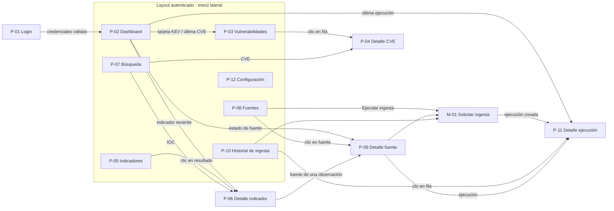

# Especificación de pantallas (UI Spec)
## Global Threat Intelligence Platform (GTIP)

**Versión:** 1.0 — Propuesta inicial  
**Estado:** Borrador para implementación del frontend  
**Área responsable:** D. Frontend (ver [PLAN-EQUIPO.md](PLAN-EQUIPO.md))  
**Stack:** React 19 + TypeScript, Vite, React Router, Recharts  
**Documentos base:** [PRD — GTIP.md](PRD%20—%20GTIP.md) y [ADD — GTIP.md](ADD%20—%20GTIP.md)

---

# 1. Introducción

## 1.1. Propósito

Este documento describe todas las pantallas del frontend de GTIP: qué muestra cada una, qué acciones permite, cómo se llega a ella, qué endpoints de la API consume y qué estados debe contemplar (carga, vacío, error).

Complementa al PRD (qué debe hacer el producto) y al ADD (cómo está construido). Cuando una pantalla se implemente o cambie, este documento debe actualizarse en el mismo PR.

## 1.2. Estado actual del frontend

A la fecha de este documento, `frontend/src` contiene solo la plantilla inicial de Vite. Ya están instaladas las dependencias que se usarán:

- `react-router-dom` para las rutas.
- `recharts` para las gráficas del dashboard.

Además, la infraestructura ya define dos restricciones que afectan al diseño:

- **Proxy de `/api`:** en desarrollo, Vite reenvía `/api` a `http://localhost:8000` ([vite.config.ts](../frontend/vite.config.ts)); en Cloudflare Pages lo hace la función [functions/api/[[path]].ts](../frontend/functions/api/[[path]].ts). El frontend siempre llama a rutas relativas `/api/v1/...`.
- **Content-Security-Policy** ([public/_headers](../frontend/public/_headers)): solo se permiten scripts, estilos, fuentes, imágenes y conexiones del propio dominio. **No se pueden usar fuentes de Google, CDNs, imágenes externas ni favicons de terceros.** Todo recurso debe estar dentro del proyecto.

## 1.3. Convenciones

Igual que en el ADD:

- **Definido:** procede del PRD o del ADD.
- **Propuesto:** decisión de este documento para poder implementar; puede cambiarse.
- **Pendiente:** depende de una decisión abierta del equipo (ver §10).

---

# 2. Mapa de pantallas

| ID | Pantalla | Ruta (propuesta) | Acceso | Endpoints principales | Semana |
|---|---|---|---|---|---|
| P-01 | Inicio de sesión | `/login` | Pública | `POST /auth/login` | 5 |
| P-02 | Dashboard | `/` | Autenticado | `GET /dashboard` | 5 |
| P-03 | Vulnerabilidades | `/vulnerabilidades` | Autenticado | `GET /vulnerabilities` | 1–2 |
| P-04 | Detalle de vulnerabilidad | `/vulnerabilidades/:cveId` | Autenticado | `GET /vulnerabilities/{cve_id}` | 2 |
| P-05 | Indicadores (buscador IOC) | `/indicadores` | Autenticado | `GET /indicators` | 3 |
| P-06 | Detalle de indicador | `/indicadores/:indicatorId` | Autenticado | `GET /indicators/{id}`, `GET /indicators/{id}/observations` | 3 |
| P-07 | Búsqueda unificada | `/buscar?q=` | Autenticado | `GET /search` (pendiente) | 4 |
| P-08 | Fuentes de inteligencia | `/fuentes` | Autenticado | `GET /sources`, `POST /ingestions` | 4 |
| P-09 | Detalle de fuente | `/fuentes/:sourceId` | Autenticado | `GET /sources/{id}`, `GET /ingestions?source_id=` | 4 |
| P-10 | Historial de ingesta | `/ingestas` | Autenticado | `GET /ingestions` | 4 |
| P-11 | Detalle de ejecución | `/ingestas/:runId` | Autenticado | `GET /ingestions/{run_id}` | 4 |
| P-12 | Configuración técnica | `/configuracion` | Autenticado | `GET /health`, `GET /auth/me` | 6 |
| P-13 | Página no encontrada | `*` | Pública | — | 1 |
| M-01 | Modal «Solicitar ingesta» | (modal sobre P-08, P-09, P-10) | Autenticado | `POST /ingestions` | 4 |

Notas:

- Todos los endpoints llevan el prefijo `/api/v1`. Los nombres siguen el ADD §11.2; si el equipo elige los del PRD (`/ingestion/runs`, `/dashboard/summary`), solo cambia la capa de cliente API, no las pantallas.
- Las rutas están en español porque son visibles para el usuario. **Propuesto.**
- La columna «Semana» sigue el calendario del área D en el plan de equipo.

## 2.1. Diagrama de navegación



---

# 3. Estructura general de la interfaz

## 3.1. Layout autenticado

Todas las pantallas salvo P-01 y P-13 comparten el mismo layout (PRD §17: «navegación lateral y un diseño orientado a la investigación técnica»).

```text
┌──────────────┬─────────────────────────────────────────────────────┐
│  GTIP        │  [ Buscar CVE, IP, dominio, URL o hash… ]   usuario ▾│
│              ├─────────────────────────────────────────────────────┤
│  Dashboard   │                                                     │
│  Vulnerab.   │  Título de la pantalla                              │
│  Indicadores │  Migas de pan (en pantallas de detalle)             │
│  Búsqueda    │                                                     │
│  Fuentes     │  Contenido                                          │
│  Historial   │                                                     │
│  ─────────   │                                                     │
│  Config.     │                                                     │
└──────────────┴─────────────────────────────────────────────────────┘
```

**Menú lateral** (definido, PRD §17.1), en este orden:

1. Dashboard → `/`
2. Vulnerabilidades → `/vulnerabilidades`
3. Indicadores → `/indicadores`
4. Búsqueda → `/buscar`
5. Fuentes de inteligencia → `/fuentes`
6. Historial de ingesta → `/ingestas`
7. Configuración técnica → `/configuracion`

La opción activa se resalta según la ruta actual (incluidas sus subrutas: `/vulnerabilidades/CVE-…` resalta «Vulnerabilidades»).

**Barra superior** (propuesto):

- Campo de búsqueda global. Al pulsar Enter navega a `/buscar?q=<texto>` (P-07).
- Nombre del usuario autenticado (de `GET /auth/me`) con menú: «Configuración» y «Cerrar sesión».

**Ancho reducido:** por debajo de ~768 px el menú lateral se oculta detrás de un botón de menú. Las tablas se desplazan horizontalmente dentro de su contenedor, nunca la página entera.

## 3.2. Cómo se accede a las pantallas (autenticación)

Definido en ADD §12.1: todas las páginas funcionales requieren sesión.

1. Cualquier ruta del layout autenticado está envuelta en una ruta protegida.
2. Si no hay sesión válida, se redirige a `/login` recordando la ruta original para volver después del inicio de sesión.
3. Si la API responde `401` en cualquier pantalla (token caducado o inválido), se cierra la sesión local y se redirige a `/login` con el mensaje «Tu sesión ha caducado. Vuelve a iniciar sesión.».
4. Si el usuario ya tiene sesión y abre `/login`, se le envía a `/`.
5. No hay registro público ni recuperación de contraseña: las cuentas se crean con un comando del backend (ADD §6.3). La pantalla de login no debe mostrar enlaces a esas funciones.

**Pendiente:** dónde se guarda el token (cookie segura `HttpOnly` o memoria del frontend), ADD §22.3. Si se elige cookie, el frontend no lee el token: solo consulta `GET /auth/me` para saber si hay sesión. Si se elige token en el frontend, se recomienda guardarlo en memoria y no en `localStorage`.

**Pendiente:** si el equipo decide que los endpoints de lectura sean públicos en la demo (PRD §10.6), P-02 a P-07 dejarían de requerir sesión y solo M-01 la exigiría.

## 3.3. Organización del código (propuesta)

```text
frontend/src/
├── main.tsx              Punto de entrada y router
├── api/                  Cliente HTTP y funciones por recurso (vulnerabilities.ts, indicators.ts…)
├── auth/                 Contexto de sesión y ruta protegida
├── layout/               Layout autenticado, menú lateral, barra superior
├── components/           Piezas reutilizables (tabla, paginación, badges, estados vacíos…)
└── pages/                Una carpeta o archivo por pantalla (Login, Dashboard, Vulnerabilities…)
```

---

# 4. Reglas comunes a todas las pantallas

Estas reglas vienen de los criterios de aceptación del PRD (§10, §16, §19.4) y aplican a todas las pantallas.

## 4.1. Estados de datos

Cada bloque que carga datos de la API debe tener los cuatro estados:

| Estado | Qué se muestra |
|---|---|
| Cargando | Esqueleto o indicador de carga en el bloque, no en toda la página |
| Con datos | El contenido normal |
| Vacío | Mensaje que explique por qué no hay datos y qué hacer (p. ej. «Aún no hay vulnerabilidades. Ejecuta una ingesta de CISA KEV desde Fuentes.») |
| Error | Mensaje comprensible y botón «Reintentar». Nunca trazas internas ni el JSON del error |

Un bloque con error no debe tumbar el resto de la pantalla: si falla la gráfica del dashboard, las tarjetas siguen visibles.

## 4.2. Mensajes de error por código HTTP

| Código | Mensaje propuesto |
|---|---|
| 400 / 422 | Mostrar el problema junto al campo («El valor no es un hash SHA-256 válido») |
| 401 | Redirigir a login (§3.2) |
| 403 | «No tienes permiso para realizar esta acción.» |
| 404 | En pantallas de detalle: estado «no encontrado» de esa pantalla (no la P-13) |
| 409 | «Ya hay una ingesta pendiente o en ejecución para esta fuente.» |
| 429 | «Demasiadas solicitudes. Espera un momento e inténtalo de nuevo.» |
| 500 / 502 / 503 | «El servidor no pudo completar la solicitud. Los datos ya almacenados siguen disponibles.» |
| Sin conexión | «No se pudo conectar con el servidor.» |

## 4.3. Valores desconocidos

El PRD insiste en que un dato ausente no es cero (§9.2, §10.1, §10.2).

- Un CVSS ausente se muestra como «Sin puntuación» (texto gris), nunca como `0` ni `0.0`.
- Una fecha ausente se muestra como «—» con un `title` «No proporcionada por la fuente».
- Un contador que la API no devuelve se muestra como «—», no como `0`.

## 4.4. Procedencia y fechas

Todo dato que venga de una fuente externa se acompaña de:

- El nombre de la fuente (badge con el nombre: «CISA KEV», «NVD», «URLhaus»…).
- La fecha que publicó la fuente y, por separado, la fecha en que GTIP la obtuvo (ADD §9.3). Etiquetas propuestas: «Publicado por la fuente» y «Obtenido por GTIP».

Las fechas se muestran en formato local (`28 oct 2026, 14:05`) con la fecha ISO completa en el `title` para quien la necesite exacta.

## 4.5. Tratamiento seguro de indicadores

Las URLs, dominios e IPs de la plataforma son datos potencialmente maliciosos (PRD §15.3 y §16).

- **Nunca** se renderizan como enlaces clicables ni se cargan como imagen, iframe o favicon.
- Se muestran en fuente monoespaciada, como texto, con un botón «Copiar».
- Se recomienda mostrarlos «desactivados» (`hxxp://ejemplo[.]com`) y copiar el valor original. **Propuesto.**
- Los enlaces a referencias de la fuente (página de la CVE en NVD, entrada de URLhaus) sí pueden ser enlaces, con `target="_blank"` y `rel="noopener noreferrer"`.

## 4.6. Lenguaje de la interfaz

Un indicador encontrado no significa «malicioso» y uno no encontrado no significa «seguro» (PRD §10.3, §16).

- Usar «Reportado por N fuentes», no «Malicioso».
- Usar «Sin coincidencias en los datos almacenados», nunca «Limpio» o «Seguro».
- No usar mapas de ataques ni cifras geográficas inventadas (PRD §17.2).

## 4.7. Listados

- Paginados siempre (PRD §15.1). Tamaño por defecto: 20 filas; selector 20 / 50 / 100.
- Los filtros, el orden y la página se guardan en la URL (`?is_kev=true&page=2`), para que el botón Atrás del navegador funcione y se puedan compartir búsquedas. **Propuesto.**
- Toda la fila es clicable y lleva a su detalle; el identificador principal es además un enlace para poder abrirlo en otra pestaña.

## 4.8. Badges de estado

**Estado de ejecución de ingesta.** Pendiente la lista definitiva (PRD §9.5 vs ADD §8.3), así que el componente debe aceptar ambas:

| Estado API | Texto | Color |
|---|---|---|
| `pending` | Pendiente | Gris |
| `running` | En ejecución | Azul (con animación) |
| `success` / `completed` | Completada | Verde |
| `partial` | Parcial | Ámbar |
| `failed` | Fallida | Rojo |

**Severidad CVSS** (rangos estándar CVSS v3):

| Puntuación | Texto |
|---|---|
| 9.0 – 10.0 | Crítica |
| 7.0 – 8.9 | Alta |
| 4.0 – 6.9 | Media |
| 0.1 – 3.9 | Baja |
| 0.0 | Ninguna |
| ausente | Sin puntuación |

**KEV:** badge rojo «Explotada (KEV)» cuando `is_kev` / `is_known_exploited` es verdadero. Cuando es falso no se muestra nada en la tabla (la ausencia de KEV no se destaca).

El color nunca es la única señal: el badge siempre lleva texto.

---

# 5. Acceso y sesión

## P-01. Inicio de sesión

| | |
|---|---|
| **Ruta** | `/login` |
| **Acceso** | Pública. Es la pantalla a la que se redirige cualquier ruta protegida sin sesión |
| **Endpoints** | `POST /api/v1/auth/login`, después `GET /api/v1/auth/me` |
| **Origen** | ADD §6.1, §6.3, §12 |

**Objetivo:** que un usuario con cuenta entre en la aplicación.

**Contenido:**

- Logotipo y nombre «Global Threat Intelligence Platform».
- Campo «Usuario o correo» (pendiente: el ADD admite `username` o `email`).
- Campo «Contraseña» con botón para mostrar u ocultar.
- Botón «Iniciar sesión».
- Zona de mensaje de error.

**Comportamiento:**

1. El botón se desactiva mientras se envía y muestra «Entrando…».
2. Con credenciales correctas, se navega a la ruta que el usuario intentaba abrir o, si no había, a `/`.
3. Con credenciales incorrectas (`401`): «Usuario o contraseña incorrectos.» Mismo mensaje para usuario inexistente y contraseña errónea, para no revelar qué cuentas existen.
4. Cuenta desactivada (`is_active = false`, `403`): «Esta cuenta está desactivada.»
5. `429`: «Demasiados intentos. Espera un momento.»
6. La contraseña nunca se guarda ni se registra en consola.

**No incluye:** registro, «olvidé mi contraseña», inicio de sesión con terceros.

---

# 6. Inteligencia: dashboard, vulnerabilidades e indicadores

## P-02. Dashboard

| | |
|---|---|
| **Ruta** | `/` |
| **Acceso** | Autenticado. Pantalla inicial tras iniciar sesión y primera opción del menú |
| **Endpoints** | `GET /api/v1/dashboard` (o `/dashboard/summary`, pendiente) |
| **Origen** | PRD §10.1, §17.2; ADD §15.3 |

**Objetivo:** dar un resumen del contenido de la base de datos y del estado operativo de las fuentes.

**Contenido, de arriba abajo:**

1. **Tarjetas de estadísticas**
   - Vulnerabilidades almacenadas → clic: `/vulnerabilidades`
   - Vulnerabilidades en KEV → clic: `/vulnerabilidades?is_kev=true`
   - Indicadores únicos → clic: `/indicadores`
   - Observaciones recientes (últimos 7 días; el periodo se indica en la tarjeta) → clic: `/indicadores`
2. **Estado de las fuentes:** una fila por fuente con nombre, badge del estado de su última ejecución y «Última ingesta correcta: hace 3 h». Clic: `/fuentes/:sourceId`.
3. **Distribución por CVSS** (Recharts, barras): una barra por severidad de §4.8 más una barra separada «Sin puntuación» con otro estilo. Clic en una barra: `/vulnerabilidades?min_cvss=<inicio del rango>`. Si no hay ninguna vulnerabilidad con CVSS, se muestra un estado vacío en lugar de una gráfica a cero.
4. **Últimas vulnerabilidades registradas** (5 filas): CVE, CVSS, KEV, fecha. Clic: `/vulnerabilidades/:cveId`. Enlace «Ver todas».
5. **Indicadores recientes** (5 filas): tipo, valor (según §4.5), fuente, fecha. Clic: `/indicadores/:indicatorId`.
6. **Últimas ejecuciones de ingesta** (5 filas): fuente, estado, inicio, registros. Clic: `/ingestas/:runId`. Enlace «Ver historial».

**Reglas:**

- Todos los valores salen de la base de datos (PRD §10.1). No hay datos de ejemplo en producción.
- Cada bloque se carga y falla por separado (§4.1).
- Si la base de datos está vacía (primer arranque), se muestra un aviso arriba: «Todavía no hay datos. Ve a Fuentes y ejecuta la primera ingesta.» con botón a `/fuentes`.

## P-03. Vulnerabilidades

| | |
|---|---|
| **Ruta** | `/vulnerabilidades` |
| **Acceso** | Autenticado. Menú lateral, tarjetas y gráfica del dashboard |
| **Endpoints** | `GET /api/v1/vulnerabilities` |
| **Origen** | PRD §10.2, §11.2, §17.3 |

**Objetivo:** consultar y priorizar vulnerabilidades conocidas.

**Barra de filtros** (cada filtro corresponde a un parámetro de la API):

| Control | Parámetro | Tipo |
|---|---|---|
| Buscar por CVE o texto | `q` | Texto. Si el texto tiene forma `CVE-AAAA-NNNN` se normaliza a mayúsculas |
| Solo explotadas (KEV) | `is_kev` | Interruptor |
| CVSS mínimo | `min_cvss` | Selector: Cualquiera, 4.0, 7.0, 9.0 |
| Publicada desde / hasta | `published_after`, `published_before` | Fechas |
| Ordenar por | (pendiente nombre del parámetro) | Publicación ↓, Publicación ↑, Modificación ↓ |
| Limpiar filtros | — | Botón |

**Tabla** (definida en PRD §17.3):

| Columna | Detalle |
|---|---|
| CVE | Identificador, enlace a P-04 |
| Descripción | Resumida a una o dos líneas, completa en el `title` |
| CVSS | Puntuación y badge de severidad, o «Sin puntuación» |
| KEV | Badge si aplica |
| Publicada | Fecha |
| Modificada | Fecha |

Debajo: paginación con total («1–20 de 1 245»).

**Estados particulares:**

- Sin resultados con filtros: «Ninguna vulnerabilidad coincide con los filtros.» + «Limpiar filtros».
- Si `q` es un CVE exacto y existe, se puede ir directamente a su detalle (P-04). **Propuesto.**

## P-04. Detalle de vulnerabilidad

| | |
|---|---|
| **Ruta** | `/vulnerabilidades/:cveId` (p. ej. `/vulnerabilidades/CVE-2024-3400`) |
| **Acceso** | Autenticado. Desde P-03, P-02 o P-07 |
| **Endpoints** | `GET /api/v1/vulnerabilities/{cve_id}` |
| **Origen** | PRD §6.1, §6.2, §10.2 |

**Objetivo:** ver toda la información disponible de una CVE y de dónde procede.

**Contenido:**

1. **Cabecera:** migas «Vulnerabilidades / CVE-…», identificador grande, badges de severidad y KEV, botón «Copiar CVE».
2. **Descripción** completa.
3. **Puntuación:** CVSS, versión de CVSS y vector (`CVSS:3.1/AV:N/…`) en monoespaciada. Si no hay: «La fuente no ha publicado una puntuación CVSS.»
4. **Fechas:** publicación, última modificación (de NVD), y «Obtenido por GTIP» / «Actualizado en GTIP».
5. **Bloque KEV** (solo si está en KEV; datos del PRD §6.1): proveedor y producto, nombre de la vulnerabilidad, fecha de incorporación al catálogo, fecha límite de remediación, acción recomendada.
6. **Referencias técnicas** (NVD): lista de enlaces externos con su dominio visible.
7. **Procedencia:** qué fuentes aportaron datos de esta CVE (CISA KEV, NVD) y cuándo se sincronizó cada una.

**Estados particulares:**

- `404`: «CVE-… no está en la base de datos de GTIP.» con la aclaración «Puede existir pero no haberse sincronizado todavía.» y enlace a la ficha pública de NVD.

**Pendiente:** el modelo del ADD §10.1 no incluye los campos KEV de proveedor, producto, fecha límite y acción. Hay que acordar con el área A si se guardan como columnas o en los datos de procedencia.

## P-05. Indicadores (buscador IOC)

| | |
|---|---|
| **Ruta** | `/indicadores` |
| **Acceso** | Autenticado. Menú lateral, dashboard, búsqueda unificada |
| **Endpoints** | `GET /api/v1/indicators`, `GET /api/v1/sources` (para el filtro) |
| **Origen** | PRD §10.3, §11.2, §17.4 |

**Objetivo:** buscar un indicador de compromiso en los datos almacenados y explorar los indicadores existentes.

**Buscador:**

| Control | Parámetro | Detalle |
|---|---|---|
| Valor | `value` | IP, dominio, URL o hash |
| Tipo | `type` | «Detectar automáticamente», IPv4, IPv6, Dominio, URL, MD5, SHA-1, SHA-256 |
| Fuente | `source_id` | Lista de fuentes |
| Buscar | — | Botón (también Enter) |

**Validación en el navegador** antes de llamar a la API (PRD §10.3):

- Con «Detectar automáticamente», se muestra junto al campo el tipo detectado («Detectado: SHA-256»).
- Si el valor no encaja con el tipo elegido, se muestra el error junto al campo y no se envía.
- La validación del backend sigue siendo la que vale; el frontend solo evita peticiones inútiles.

**Resultados:** tabla con tipo, valor (según §4.5), número de fuentes que lo reportan, primera y última vez visto. Clic: P-06.

Sin búsqueda, la pantalla lista los indicadores más recientes con los mismos filtros.

**Estados particulares:**

- Sin coincidencias: «Sin coincidencias en los datos almacenados. Esto no significa que el indicador sea seguro.» (PRD §10.3).
- La búsqueda **nunca** dispara consultas a proveedores externos (PRD §10.3). La consulta externa está en P-06.

## P-06. Detalle de indicador

| | |
|---|---|
| **Ruta** | `/indicadores/:indicatorId` |
| **Acceso** | Autenticado. Desde P-05, P-02 o P-07 |
| **Endpoints** | `GET /api/v1/indicators/{id}`, `GET /api/v1/indicators/{id}/observations` |
| **Origen** | PRD §10.3, §10.4, §17.4; ADD §9 |

**Objetivo:** reunir todas las evidencias sobre un indicador, agrupadas por fuente (correlación básica).

**Contenido:**

1. **Cabecera:** migas, tipo (badge), valor según §4.5 con «Copiar», resumen «Reportado por 2 fuentes · 5 observaciones · visto por primera vez el …».
2. **Observaciones agrupadas por fuente** (correlación, PRD §10.4): una sección por fuente con:
   - Nombre de la fuente (enlace a P-09).
   - Tabla de observaciones: identificador externo, primera vez vista, última vez vista, fecha de obtención por GTIP, estado o etiquetas que dé la fuente, enlace a la referencia externa.
   - «Ver datos originales»: desplegable con los datos relevantes de la fuente (`raw_data` / `source_data`) como JSON de solo lectura.
3. **Diferencias entre fuentes:** si las fuentes discrepan en fechas o en clasificación, se muestran lado a lado (PRD §10.4).
4. **Reputación bajo demanda** (solo para IP y solo si AbuseIPDB está habilitado; opcional en el MVP):
   - Botón «Consultar reputación en AbuseIPDB».
   - El resultado se marca claramente como «Consulta externa realizada el …», separado de los datos almacenados (PRD §10.3).
   - Si la fuente no está configurada, el bloque no aparece o aparece como «AbuseIPDB no está habilitado».
5. **Aviso fijo** al pie: «La coincidencia entre fuentes no demuestra que los reportes pertenezcan a una misma campaña o actor.» (PRD §10.4).

**Estados particulares:** `404` → «Este indicador no existe en GTIP.» con enlace a P-05.

**Pendiente:** endpoint de la consulta de reputación bajo demanda (no está en las tablas de endpoints del PRD ni del ADD).

## P-07. Búsqueda unificada

| | |
|---|---|
| **Ruta** | `/buscar?q=<texto>` |
| **Acceso** | Autenticado. Menú lateral y campo de búsqueda de la barra superior (desde cualquier pantalla) |
| **Endpoints** | `GET /api/v1/search?q=` (PRD §11.1; no aparece en el ADD — pendiente) |
| **Origen** | PRD §11.1, §17.1 |

**Objetivo:** un solo campo para buscar cualquier cosa sin elegir antes dónde.

**Comportamiento propuesto:**

1. El texto se clasifica: CVE, IPv4/IPv6, dominio, URL, MD5, SHA-1, SHA-256 o texto libre.
2. Si es un CVE o un IOC con coincidencia exacta, se navega directamente a su detalle (P-04 o P-06).
3. En otro caso se muestran resultados en dos grupos: «Vulnerabilidades» e «Indicadores», cada uno con sus 5 primeros resultados y «Ver todos» que lleva a P-03 o P-05 con el filtro aplicado.
4. Sin `q`, la pantalla muestra solo el campo y ejemplos de lo que se puede buscar.

**Alternativa si no se implementa `/search`:** la pantalla llama a `GET /vulnerabilities?q=` y `GET /indicators?value=` en paralelo. El resultado visual es el mismo.

---

# 7. Operación: fuentes e ingesta

## P-08. Fuentes de inteligencia

| | |
|---|---|
| **Ruta** | `/fuentes` |
| **Acceso** | Autenticado. Menú lateral y bloque «Estado de las fuentes» del dashboard |
| **Endpoints** | `GET /api/v1/sources`, `POST /api/v1/ingestions` (vía M-01) |
| **Origen** | PRD §10.5, §17.5; ADD §7 |

**Objetivo:** comprobar qué fuentes están integradas y si funcionan.

**Contenido:** una tarjeta (o fila) por fuente:

| Campo | Detalle |
|---|---|
| Nombre y descripción | «CISA KEV — Vulnerabilidades explotadas conocidas» |
| Habilitada | Sí / No. Si no lo está, el motivo («Falta ABUSEIPDB_API_KEY»), sin mostrar nunca el valor de una clave |
| Estado de la última ejecución | Badge de §4.8 |
| Último intento | Fecha |
| Última ingesta correcta | Fecha y «hace X» |
| Registros de la última ejecución | Procesados / nuevos / actualizados |
| Último error | Mensaje resumido, si lo hay |
| Acciones | «Ver detalle» (P-09) y «Ejecutar ingesta» (M-01) |

**Reglas:**

- El estado de la fuente se basa en sus últimas ejecuciones, no en que exista configuración (PRD §10.5). Una fuente habilitada sin ejecuciones se muestra como «Sin ejecuciones todavía».
- Debajo del título, aviso: «El estado indica el resultado técnico de la ingesta, no la exactitud ni la completitud de los datos.» (PRD §17.5).
- «Ejecutar ingesta» se desactiva si la fuente no está habilitada o si ya tiene una ejecución `pending` / `running`.
- Mientras alguna fuente tenga una ejecución `pending` o `running`, la pantalla vuelve a consultar `GET /sources` cada 10 s para actualizar el estado. **Propuesto.**

## P-09. Detalle de fuente

| | |
|---|---|
| **Ruta** | `/fuentes/:sourceId` |
| **Acceso** | Autenticado. Desde P-08, el dashboard y el nombre de la fuente en P-06 |
| **Endpoints** | `GET /api/v1/sources/{id}` (PRD §11.1; no en ADD — pendiente), `GET /api/v1/ingestions?source_id=` |
| **Origen** | PRD §10.5, §11.1 |

**Objetivo:** ver la información de una fuente y su historial completo.

**Contenido:**

1. Cabecera con nombre, estado, botón «Ejecutar ingesta» (M-01).
2. Datos de la fuente: descripción, URL documentada (enlace externo), tipo, si requiere clave, habilitada, frecuencia de actualización configurada.
3. Métricas: última ingesta correcta, último error.
4. Historial de ejecuciones de esta fuente: misma tabla que P-10 con el filtro de fuente fijado.

**Alternativa si no se implementa `GET /sources/{id}`:** obtener la fuente de la lista de `GET /sources`.

## P-10. Historial de ingesta

| | |
|---|---|
| **Ruta** | `/ingestas` |
| **Acceso** | Autenticado. Menú lateral y enlace «Ver historial» del dashboard |
| **Endpoints** | `GET /api/v1/ingestions` (o `/ingestion/runs`, pendiente) |
| **Origen** | PRD §10.5, §11.1; ADD §8.3, §13.1 |

**Objetivo:** consultar todas las ejecuciones de ingesta, periódicas y manuales.

**Filtros:** fuente, estado, tipo de disparo (programada / manual, `trigger_type`), intervalo de fechas.

**Tabla:**

| Columna | Detalle |
|---|---|
| Fuente | Nombre |
| Estado | Badge de §4.8 |
| Disparo | «Programada» o «Manual» (y quién la pidió, si la API lo expone) |
| Inicio | Fecha |
| Duración | Calculada de inicio y fin; «En curso» si no ha terminado |
| Procesados / Nuevos / Actualizados | Números |
| Errores | Número y primera línea del resumen |

Clic en una fila: P-11. Botón «Solicitar ingesta» arriba a la derecha (M-01).

Mientras haya filas `pending` o `running` visibles, la tabla se actualiza sola cada 10 s. **Propuesto.**

## P-11. Detalle de ejecución

| | |
|---|---|
| **Ruta** | `/ingestas/:runId` |
| **Acceso** | Autenticado. Desde P-10, P-09, el dashboard y tras crear una ingesta en M-01 |
| **Endpoints** | `GET /api/v1/ingestions/{run_id}` |
| **Origen** | ADD §8.3, §11.2 |

**Contenido:**

1. Fuente, estado, tipo de disparo, quién la solicitó (si es manual).
2. Línea de tiempo: solicitada → reclamada por el worker → iniciada → finalizada.
3. Contadores: recibidos, procesados, nuevos, actualizados, errores.
4. Resumen de errores, tal como lo devuelve la API (que no debe contener secretos, ADD §8.3).
5. Si está `pending` o `running`, se actualiza cada 5 s hasta que termina. **Propuesto.**

## M-01. Modal «Solicitar ingesta manual»

| | |
|---|---|
| **Se abre desde** | «Ejecutar ingesta» en P-08 y P-09; «Solicitar ingesta» en P-10 |
| **Acceso** | Autenticado (endpoint administrativo, PRD §11.1) |
| **Endpoints** | `POST /api/v1/ingestions` |
| **Origen** | ADD §8.2 |

**Contenido:**

- Fuente: ya elegida si se abre desde una fuente; selector con las fuentes habilitadas si se abre desde P-10.
- Texto: «Se pedirá al worker que sincronice «CISA KEV». La ingesta se ejecuta en segundo plano; puedes seguir usando la aplicación.»
- Botones «Cancelar» y «Solicitar ingesta».

**Comportamiento:**

1. Al confirmar se envía `POST /ingestions`. El botón muestra «Solicitando…».
2. Con éxito, la API devuelve el identificador de la ejecución: se cierra el modal y se muestra un aviso «Ingesta solicitada» con enlace «Ver progreso» a `/ingestas/:runId`.
3. `409`: «Ya hay una ingesta pendiente o en ejecución para esta fuente.» con enlace a esa ejecución si la API la devuelve.
4. `403`: «No tienes permiso para solicitar ingestas.»

---

# 8. Sistema

## P-12. Configuración técnica

| | |
|---|---|
| **Ruta** | `/configuracion` |
| **Acceso** | Autenticado. Última opción del menú lateral y menú del usuario |
| **Endpoints** | `GET /api/v1/health`, `GET /api/v1/auth/me`, `GET /api/v1/sources` |
| **Origen** | PRD §17.1 (el PRD la nombra pero no define su contenido) |

**Objetivo propuesto:** pantalla de solo lectura para comprobar que el sistema está bien montado. No permite editar configuración: esta vive en variables de entorno (ADD §18).

**Contenido propuesto:**

1. **Estado del sistema** (`/health`): API disponible, conexión con PostgreSQL, versión de la aplicación y entorno (`APP_ENV`).
2. **Fuentes y credenciales:** por fuente, si está habilitada y si su clave está configurada («Configurada» / «No configurada»). **Nunca** el valor de la clave.
3. **Sesión:** usuario autenticado y botón «Cerrar sesión».
4. **Enlaces:** documentación de la API (`/docs`, si está expuesta en el entorno) y repositorio.

**Pendiente:** confirmar con el área C qué datos devuelve `/health` y si hay que exponer las frecuencias de ingesta por fuente.

## P-13. Página no encontrada

| | |
|---|---|
| **Ruta** | Cualquier ruta no definida (`*`) |
| **Acceso** | Pública |

Mensaje «Esta página no existe.» y botón «Ir al dashboard» (que, sin sesión, llevará al login).

Los recursos inexistentes dentro de una ruta válida (una CVE que no está, un indicador borrado) **no** usan esta página: muestran el estado «no encontrado» de su propia pantalla de detalle.

---

# 9. Trazabilidad con los criterios del PRD

| Criterio (PRD §19.4 y §10) | Dónde se cumple |
|---|---|
| Las estadísticas reflejan datos persistidos | P-02 |
| El usuario puede consultar vulnerabilidades | P-03, P-04 |
| El usuario puede buscar indicadores | P-05, P-06, P-07 |
| Los detalles muestran procedencia y fechas | P-04, P-06, §4.4 |
| Los errores de carga se comunican de forma comprensible | §4.1, §4.2 |
| Puntuaciones ausentes distintas de reales | §4.3, P-03, P-04 |
| Sin coincidencia ≠ seguro | §4.6, P-05 |
| Distinguir dato almacenado de consulta externa | P-06 (reputación) |
| Estado de fuentes basado en ejecuciones | P-08 |
| Ingesta manual autorizada | M-01 |
| Sin mapas ni cifras inventadas | §4.6, P-02 |
| No abrir URLs maliciosas | §4.5 |
| Acceso con autenticación (ADD §12.1) | §3.2, P-01 |

---

# 10. Decisiones pendientes que afectan al frontend

Vienen de [PLAN-EQUIPO.md](PLAN-EQUIPO.md) y de este documento. Ninguna impide empezar: la capa `api/` aísla las diferencias de nombres.

1. **Rutas de ingesta y dashboard:** `/ingestions` y `/dashboard` (ADD) o `/ingestion/runs` y `/dashboard/summary` (PRD).
2. **Estados de ingesta:** `success` (PRD) o `pending` + `completed` (ADD). El badge de §4.8 acepta ambos mientras tanto.
3. **Lectura pública o con login:** cambia qué rutas están protegidas (§3.2).
4. **Almacenamiento del token:** cookie segura o memoria del frontend (§3.2).
5. **Endpoints que solo están en el PRD:** `GET /search` (P-07) y `GET /sources/{id}` (P-09). Ambas pantallas tienen alternativa sin ellos.
6. **Endpoint de reputación bajo demanda** para AbuseIPDB (P-06).
7. **Campos KEV** de proveedor, producto, fecha límite y acción recomendada (P-04).
8. **Nombre del parámetro de orden** en `GET /vulnerabilities` (P-03).
9. **Login con usuario o con correo** (P-01).
